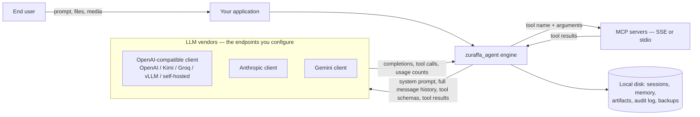

# Privacy

Last reviewed: 2026-10-31 against zuraffa_agent 7.3.2 (issue #139).
Re-review this document whenever the engine's egress or persistence
surface changes — CI keeps the authoritative list of files allowed to
touch the network or disk in the runtime purity gate
(`.github/workflows/pipeline.yml`, job `verify`).

## Scope: what this covers — and what it does not

zuraffa_agent is a **library**, not a service. The package authors run no
infrastructure and receive no data: there is no telemetry, no crash
reporting, no license check and no phone-home. The only network traffic
the engine can produce is

1. LLM calls to the endpoint **you configure** (`ProviderConfig.baseUrl`,
   env `ZFA_PROVIDER_BASE_URL`) — no vendor host is hardcoded anywhere in
   `lib/`; and
2. MCP traffic to the servers **you configure** (SSE endpoint or stdio
   subprocess).

The observability seams (crash reporter, tracer, metrics) ship as no-ops
and only emit where you inject an implementation.

When you build an application on zuraffa_agent, **your application is the
data controller** (GDPR) / the "business" (CCPA) for everything the agent
processes; the LLM vendors and MCP servers you configure act as
processors / service providers. Everything in this document is therefore
material **you must surface to your users** — see
[Your responsibilities as a consumer](#your-responsibilities-as-a-consumer).

## Data flow at a glance

## What leaves the machine

Every mission turn sends the **full transcript** to the configured LLM
provider — the mission runner relays system, user, assistant, steering
and tool messages each turn. Concretely, a request body contains:

- **Model id and sampling settings** (temperature, max tokens).
- **The system prompt**, including the *memory projection*: top long-term
  and session memory records rendered as prompt lines
  (`MemoryPromptProjection`), plus operator-supplied skill text loaded
  from local `SKILL.md` files.
- **The entire message history**, including prior assistant messages.
- **Tool definitions** with their full JSON schemas (`LlmToolSpec`).
- **Tool calls and tool results verbatim** — whatever your tools and MCP
  servers return (file contents, command output, API responses) becomes
  message content on the next turn. This is the main PII channel: the
  engine does not redact names, emails or file paths. The shipped
  `RegexToolResultSanitizer` scrubs *credentials* (AWS keys, GitHub
  tokens, JWTs, PEM blocks, Slack/Stripe keys) from tool output before it
  joins the transcript, but it is **opt-in** — wire it via
  `MissionRunner`'s `toolResultSanitizer` or raw tool output goes to the
  vendor.
- **Multimodal payloads inline as base64** (`ImageBlock` / `AudioBlock` /
  `DocumentBlock`) — images, audio and documents the user or tools
  supply travel in the request body.
- **Steering messages** from your UI become user messages.
- **Context compaction makes an extra vendor call**: when compaction runs,
  the compressed head of the transcript is sent to the same client for
  summarization, and the snapshot (plus the original messages) is stored
  in episodic memory — see below.
- **Eval judges** (`LlmJudgeGrader`) send mission output to the configured
  judge client.
- **Trace context**: a W3C `traceparent` header may be propagated into
  request headers — a trace id, not content.

Token **usage counts** flow *inbound* only; they are never sent back to a
vendor.

Tool results larger than the artifact threshold (256 KB by default) are
kept out of the prompt and handed to the artifact store instead — which
ships **in-memory**; if you back it with a file store, you decide where
those bytes live.

## MCP servers

- `tools/call` sends the **tool name and the full arguments map** to the
  configured MCP server; SSE transports additionally carry an optional
  bearer token you supply. Stdio transports spawn a local subprocess —
  no auth material on that channel.
- MCP-supplied tool descriptions and schemas are bridged into the
  model-facing registry, i.e. **third-party-controlled text enters the
  tool-selection prompt** (threat T3 in [SECURITY.md](SECURITY.md)).
- The MCP layer itself persists nothing; tool calls are recorded locally
  only through the stores below.

## What stays on local disk

All paths are caller-supplied — the engine writes nothing outside the
location you give it. The canonical layout is the `AgentPlatform` agent
home (Application Support on Apple platforms, `filesDir` on Android),
resolved into pinned `sessions/`, `memory/` and `artifacts/`
subdirectories; an unset home makes the engine **throw** rather than
scatter data in the working directory.

| Store | What it contains | Notes |
| --- | --- | --- |
| Hive session store (`hive_session_store.dart`) | Session tree: messages (full prompts/responses/tool payloads), **raw tool arguments**, usage counts | Binary boxes; entry box name is yours, meta box `_zuraffa_meta`. Location is Hive's default unless you init Hive yourself. Not cross-process safe. |
| JSONL session store (`jsonl_session_storage.dart`) | Same tree, one JSON line per entry, `_schema`/`_meta` headers | Path is your argument; corrupt-tail recovery, atomic rewrites via `<path>.migrating`/`.rewriting` temps. |
| Turn records / tool invocation records / usage ledger (`jsonl_entity_storage.dart`) | Turn ids and timings, tool name + error flag + duration, token counts | References message/tool entries by id; persists via the same JSONL adapter; null path = in-memory only. |
| Persistent memory (`persistent_agent_memory.dart`) | Long-term memory records: content text, tags, salience, and source identity (`sessionId`, `missionId`, `agentName`) | Single JSON file at `store.file`, atomic writes. Episodic memories (summary **plus full original messages**) mirror into the session store as custom entries. |
| Audit log (`jsonl_audit_sink.dart`, issue #132) | Append-only events: provider config (providerId, kind, **baseUrl**, models), tool invocations, approval decisions, breaker transitions | Tool arguments and results are stored as **unsalted SHA-256 hashes**, never raw payloads; key material is forbidden. Rotation renames `<path>.<epochMs>`; expired archives deleted by `maxAge`. |
| Session backups (`session_backup.dart`) | Full session tree copies with a `_backup` provenance header | Written atomically; `<path>.backup.1..N` generation rotation when enabled (default **off**). |
| Session locks (`session_lock.dart`) | Nothing — advisory `<path>.lock` sidecars for single-writer enforcement | Removed best-effort on release. |

**API keys are never persisted by the engine.** Credentials are
constructor-injected (or resolved through your `SecretResolver`); the
platform secure store (`AgentPlatform.secureRead/Write/Delete`, e.g.
Keychain/Keystore) is host-owned and throws until a host registers an
implementation. Keys transit request headers only.

## Logging

- The engine logs through the `AgentLog` facade over `package:logging`
  and **never prints** — with no sink installed there is zero console
  output. You decide what happens to records by installing a sink.
- Production call sites log lifecycle and resilience events only (mission
  id + outcome, token counts). The `FINE` level is *reserved* for wire
  bytes but no `lib/` code currently emits request/response bodies.
- Two things can still carry content into your sink: vendor **error
  bodies** (an HTTP failure surfaces as `LlmHttpException`, whose message
  embeds the provider's response body) and whatever your own tools log.
  API keys and request headers are never rendered.
- Crash-reporter context is contractually identifiers-only — payloads and
  secrets are forbidden by the `CrashReporter` contract docs.

## Retention on local disk

**Everything is kept indefinitely by default.** Every store defaults to
`RetentionPolicy.unlimited()`, backup rotation defaults to off, and the
audit log's active segment never expires. Retention only happens if you
wire it:

- `RetentionPolicy` (max age / max count / max bytes) on session stores
  and the audit sink — see the
  [retention section of the README](README.md#retention-policies) and the
  sweep-between-missions knobs.
- `backupGenerations > 0` for N-generation backup rotation on close.
- Deletion is under your control: `prune`/`deleteEntries` APIs,
  `backup`/`restore` for portability. There is no first-class "export all
  personal data" feature; a session backup is the closest artifact.

## Vendor-side retention, GDPR and CCPA

The engine cannot answer these for you — the vendor is whatever
`baseUrl` you point at. As of the last review date, for the three
vendors whose wire protocols are shipped:

| Vendor (client) | Training on your API data | Vendor-side retention |
| --- | --- | --- |
| Anthropic (`AnthropicClient`) | No — the Commercial Terms state Anthropic may not train models on Customer Content from the API | Destroyed on request / retained only as needed per the terms; DPA governs processing (EEA/UK/CH customers under Irish law) |
| OpenAI-compatible (`OpenAiCompatibleClient`) | No by default for the OpenAI API Platform (opt-in only) | Inputs/outputs retained up to 30 days for abuse monitoring, then removed unless legally required |
| Google Gemini (`GeminiClient`) | **Paid tier: no. Unpaid tier: yes** — Google uses unpaid-tier content to improve its products | Paid tier: prompts/responses logged for a limited period solely for abuse monitoring; may be cached transiently "in any country" Google maintains facilities |

Primary sources (verify before relying — these change):
[Anthropic Commercial Terms](https://www.anthropic.com/legal/commercial-terms),
[OpenAI API data privacy](https://openai.com/api-data-privacy/),
[Gemini API Terms](https://ai.google.dev/gemini-api/terms).

GDPR framing: you are the controller; your vendor DPA (all three offer
one) is the processor contract; EU→US transfers ride the vendor's SCCs —
see [docs/DATA_RESIDENCY.md](docs/DATA_RESIDENCY.md). Data subject
requests for *vendor-retained* copies go through the vendor's tools;
local copies are yours to delete. CCPA/CPRA framing: configured vendors
act as service providers under their DPA, and your application owes its
users notice at collection — which is what this document's consumer
checklist implements.

## Your responsibilities as a consumer

If you ship an application that embeds zuraffa_agent:

1. **Disclose before the first prompt.** Your UI and privacy policy must
   state that prompts, files/media, tool results and (where applicable)
   MCP calls are transmitted to the LLM vendor(s) **you** configured, and
   link their terms. Name the vendors — "the AI provider" is not
   disclosure.
2. **Obtain consent** where your jurisdiction requires it (EU: explicit
   consent or another lawful basis; several US states: opt-out of
   profiling where applicable).
3. **Surface vendor-side retention** (table above) and the fact that
   content is processed outside your control once sent.
4. **Wire the controls the engine ships**: the credential sanitizer
   (`RegexToolResultSanitizer` + custom patterns), approval gates for
   high-risk tools, retention policies, backup rotation, and audit-log
   retention. Defaults are keep-everything, sanitize-nothing.
5. **Honor deletion**: use the `prune`/delete APIs for local data and
   rotate backups; document how users can request vendor-side deletion.
6. **Do not log payloads**: keep `FINE` uninstalled in production and
   scrub vendor error bodies before forwarding logs to third parties.
7. **Choose the endpoint deliberately**: a self-hosted
   OpenAI-compatible gateway keeps transcript data inside your perimeter
   (see [docs/DATA_RESIDENCY.md](docs/DATA_RESIDENCY.md)).

## Changes to this document

Update this document together with any PR that changes the egress or
persistence surface (new transport, new store, new vendor client). The
purity gate's dart:io allowlist and the HTTP client call sites
(`io_llm_transport.dart`, `io_sse_mcp_transport.dart`,
`llm_http_transport.dart`) are the fastest audit path.
